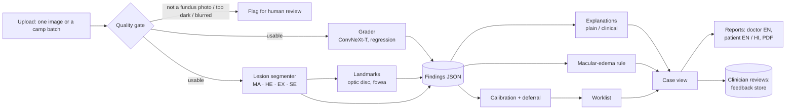

# RetinaScreen

A research prototype for diabetic-retinopathy (DR) screening decision support (shown in the app as **DrishtiQ**). It checks photo quality, suggests a severity stage with calibrated confidence and lesion evidence, and orders a clinician's worklist.

> **Research prototype, not a medical device.** It does not diagnose. A qualified clinician makes every decision. Its locked evaluation (ADR-046) did not support routing patients to routine rescreening without clinician review.

**New laptop:** follow [SETUP_NEW_LAPTOP.md](SETUP_NEW_LAPTOP.md) (run `setup.bat` once, then `start.bat`).

**Run it:** double-click `start.bat` (Windows), then open http://localhost:8000. Details: [Run it locally](#run-it-locally).

**Not included in this repository:** model weights and the datasets. Get the datasets as described in [DATA.md](DATA.md) and the model files as described in [MODELS.md](MODELS.md); `preflight.py` checks every file against `configs/app/checksums.json`.

**Team and credits:** built by the RetinaScreen / DrishtiQ hackathon team (GitHub: [codesandstorm](https://github.com/codesandstorm)). Dataset credits are under [Licences](#licences); open-source software includes PyTorch, timm, segmentation-models-pytorch, FastAPI, React, Vite, Tailwind CSS, Radix UI, Lucide icons and the Inter and DM Serif Display fonts. Contributions: see [CONTRIBUTING.md](CONTRIBUTING.md).

## What it does

1. **Grades** a colour fundus photograph on the 5-stage international (ICDR) scale and says how confident it is. When confidence is low or the image quality is poor, it **defers to a human grader** instead of guessing.
2. **Finds lesions** (microaneurysms, haemorrhages, hard and soft exudates), locates the optic disc and fovea, and estimates **macular-edema risk** from exudates near the centre of vision.
3. **Explains itself** in plain or clinical language. Every number in an explanation comes from a structured findings record, with a Grad-CAM view of where the grader looked.
4. **Organises the work:** a worklist that puts deferred and likely-referable cases first, single and screening-camp (multi-file) upload, clinician review with feedback capture, and patient-level reports: a doctor report and a patient summary in English and Hindi, as PDF.

## Key numbers

Held-out validation sets only; the external Messidor-2 evaluation has not been run yet.

<!-- KEY-NUMBERS:START (generated by tools/key_numbers.py) -->
| What | Value |
|---|---|
| Agreement with eye specialists on IDRiD-val (quadratic weighted kappa; 1 = perfect) | 0.893 [0.846-0.929] |
| Agreement with eye specialists on APTOS-val (quadratic weighted kappa; 1 = perfect) | 0.918 [0.896-0.938] |
| AI stage within one stage of the specialist's grade, IDRiD-val | 98.0% |
| Referable DR caught (sensitivity at AI stage ≥ 2), IDRiD-val | 93.7% |
| AI stage within one stage of the specialist's grade, APTOS-val | 98.1% |
| Referable DR caught (sensitivity at AI stage ≥ 2), APTOS-val | 95.0% |
| Share of the worklist read to find 95% of referable cases, IDRiD-val (random order: 95%) | 59% |
| Images the AI defers to a human grader, IDRiD-val | 8.9% |
| Share of the worklist read to find 95% of referable cases, APTOS-val (random order: 95%) | 44% |
| Images the AI defers to a human grader, APTOS-val | 6.4% |
| Non-fundus, blurred or very dark images given a confident stage (must be 0) | pending |

All values and their sources: [results/KEY_NUMBERS.md](results/KEY_NUMBERS.md).
<!-- KEY-NUMBERS:END -->

## How it works



Every model change goes through a pre-registered rule (paired bootstrap on two validation sets), recorded in `docs/research/ARCHITECTURE_DECISION_LOG.md`. Every metric is in `results/registry.csv`.

## Limitations

- Validated on two public datasets from India (IDRiD, APTOS); performance on other cameras and populations is unknown until external testing.
- Mild DR (stage 1) is often missed; microaneurysms are tiny and the training labels disagree most there.
- Macular-edema risk is a photographic proxy; true macular edema needs OCT.
- The optic disc and fovea are found by heuristics; uncertain landmarks are shown dashed.
- Grad-CAM shows where the grader looked, not where the lesions are.
- The Hindi wording awaits review by a native-speaking clinician.

## Licences

- **Code:** MIT (see [LICENSE](LICENSE)).
- **Trained model weights:** not distributed and not covered by the MIT licence. They were trained on data that includes DDR (CC BY-NC-SA 4.0), so any use is research and education only.
- **Fonts and icons (bundled, self-hosted):** Inter and DM Serif Display, both SIL Open Font License 1.1 (via `@fontsource`); Lucide icons, ISC licence.
- **Datasets** keep their own licences; no image data is in this repository:

| Dataset | Used for | Licence |
|---|---|---|
| IDRiD (Porwal et al., 2018; IEEE DataPort) | Grading training and validation; lesion masks; locked internal test | CC BY 4.0 |
| APTOS 2019 Blindness Detection (Kaggle) | Grading training and validation | Kaggle competition rules |
| MMRDR colour fundus subset (Tang et al., Sci Data 2026) | Grading training | CC BY 4.0 |
| DDR (Li et al., 2019) | Lesion-segmentation training; quality-gate check | CC BY-NC-SA 4.0 (non-commercial) |
| DeepDRiD (regular fundus) | Locked external test | CC BY-SA 4.0 |
| EyePACS 2015 (Kaggle "Diabetic Retinopathy Detection"), only if the pre-registered trigger fires | Grading training | Kaggle competition rules |
| Messidor-2 | Locked external test | ADCIS licence terms |
| RETFound (Zhou et al., 2023) | Evaluated as a frozen backbone; not used in the app | CC BY-NC 4.0 |

Thank you to the teams who collected, graded and shared these images. Follow-up suggestions follow the structure of the International Council of Ophthalmology *Guidelines for Diabetic Eye Care* (2017).

## Setup notes

The exact environment is in `requirements-lock.txt` (pip freeze). The Kaggle CLI (`kaggle` 2.2.5 with kagglesdk, protobuf 7.36.2 and jupytext) is installed only for the optional, pre-registered EyePACS step (ADR-037). It reads its own API token; the project never reads, prints or stores it.

## Run it locally

1. **Python environment:** the project expects the virtual environment at `.venv` (Python 3.11, PyTorch with CUDA). Check it with:
   `.venv\Scripts\python preflight.py`
2. **Model files:** the weights under `models/checkpoints/` are not in git. Preflight lists any that are missing and checks their SHA-256 against `configs/app/checksums.json`.
3. **Page build:** `start.bat` rebuilds the page automatically when it is older than the code (needs Node.js). To do it by hand: `cd frontend && npm install && npm run build`.
4. **Start:** double-click `start.bat`, or run `.\start.ps1` in PowerShell. It runs the preflight checks, starts the app and opens http://localhost:8000 once the models have loaded (about 30–60 s).
5. **Stop:** close the window that `start.bat` opened.

Fonts and icons are bundled and no model is downloaded at run time (`tests/test_offline.py` blocks the network and runs an analysis). Uploaded images and reviews are stored locally in `data/app/`, which is never committed.

### Troubleshooting

| Problem | What to do |
|---|---|
| **Port 8000 is in use** | Another app instance is probably running. If it is RetinaScreen at the current version, `start.bat` simply opens it. If it is an older one, run `start.bat -Restart`. Otherwise close the other program. |
| **Red banner "Backend is outdated: restart the app"** | The page and the backend come from different code versions, e.g. the code was updated while the app was running. Close the app window and run `start.bat` again. Saving cases or reviews can fail until you do. |
| **PDF download opens a print dialog** | Server-side PDF needs Microsoft Edge and a standard (non-sandboxed) start. Otherwise the app falls back to the browser's print dialog: choose **Save as PDF**. The document is the same. |
| **"The models are still loading"** | Wait a minute after starting; loading takes longer on the first run and on CPU. |
| **No GPU** | Partly verified. To run on the CPU, set `RS_DEVICE=cpu` before starting; verified on the development laptop (tests, timing, screenshots). Do **not** hide the GPU with `CUDA_VISIBLE_DEVICES=-1` on a machine that has an NVIDIA driver: with this driver the process crashes at a random moment (ADR-044). A machine with no NVIDIA GPU at all has not been tested. The retry on the CPU after the GPU runs out of memory mid-analysis is **unverified**. Timings: `results/benchmark.json`. |
| **Preflight FAIL: checksums** | A model or config file changed after it was recorded. Restore it, or run `preflight.py --record` if the change was intended (for example after an approved model swap). |
| **"This may not be an eye photo"** | The quality gate found no dark border around a round retinal field. Retake or crop the photograph; a person should check the image. |

## Tests

```bash
.venv/Scripts/python -m pytest -q backend tests
```

This includes a real-HTTP end-to-end test (`tests/test_e2e_http.py`: upload, analyse, review, worklist, reports in English and Hindi) and the offline test.

## DrishtiQ Network (community module)

The community-facing front door at `/` (`/network` redirects there): awareness content, eye-screening camp search, interest registration,
optional accounts ("My DrishtiQ"), health-worker and organiser tools, and **Saathi**, a Hindi/English/Hinglish voice and text helper.
It is a prototype of a proposed ecosystem. Camps are **demonstration data** (clearly labelled) unless an admin marks a camp verified.
It has its own database (`data/app/network.sqlite`) and shares sign-in with the specialist workspace, where clinical access requires an ophthalmologist grant.
With consent, a specialist can link a camp registration to a screening visit. Network exposes only screening progress and the signed next action; clinical images, stages and notes remain private. Design: `drishtiQ_network.md`.

- Run as usual (`start.bat`, or uvicorn + `npm run dev`); open `/` for patients, `/specialists` for the cinematic specialist entry, and `/app/worklist` for the signed-in specialist workspace. Saathi works without any API key.
- Demo mode (default, `NETWORK_DEMO_MODE=1`) seeds demonstration camps, three **prototype** staff accounts (shown on `/network/staff`), and a prototype ophthalmologist (`9000000004`, password `Demo@Eye-Doctor1`, shown on `/app/login`). Set `NETWORK_DEMO_MODE=0` for anything real; create staff with
  `python -m backend.network.cli create-staff --role organiser --name "..." --identifier 98xxxxxxxx --org "..."`.
- Optional free AI: put a Google AI Studio free-tier key in `.env` as `GEMINI_API_KEY` (see `.env.example`). It only helps understand unusual sentences, never receives personal data,
  and pauses itself on quota errors; there is no paid fallback. Without it, a deterministic Hindi/English understanding layer handles everything.
- Voice uses the browser's own speech recognition and synthesis (Chrome/Edge best); typing always works.
- Tests: `python -m pytest -q backend/network backend/test_clinical_p0.py` and, after `npm run build`, `node frontend/tests/run-ui-checks.mjs`.
- The browser journey creates synthetic accounts, registrations and screening decisions. Run a separate backend with `RS_DATA_DIR` set to a fresh temporary directory, then run `node frontend/tests/network-e2e.mjs http://127.0.0.1:8011`. See the script header for setup; `E2E_IMAGE` optionally adds the image-based clinical checks. Keep this test server separate from your normal worklist.
